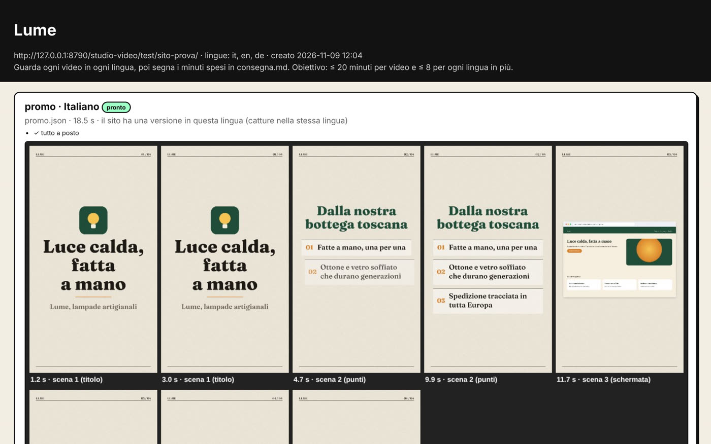
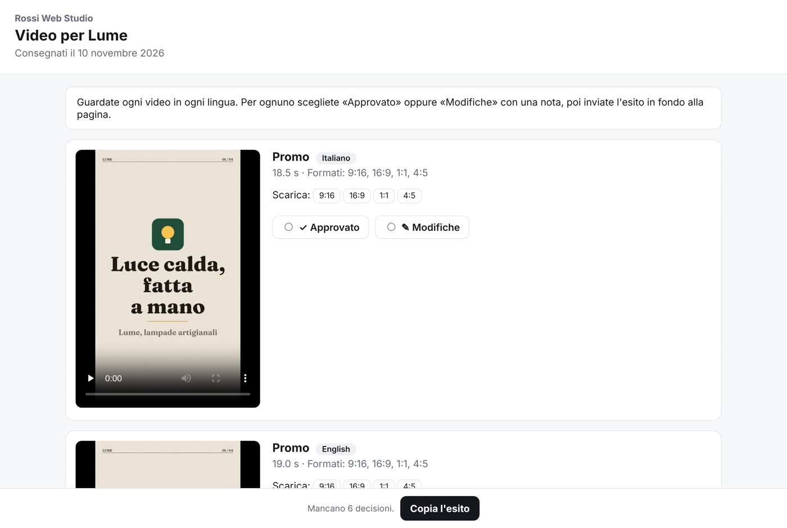
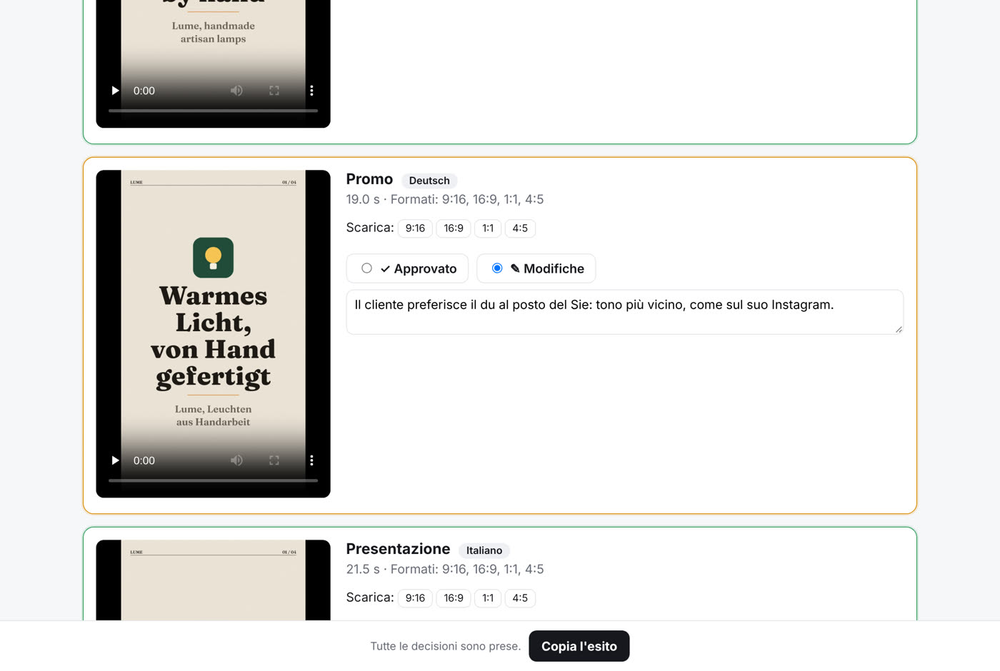
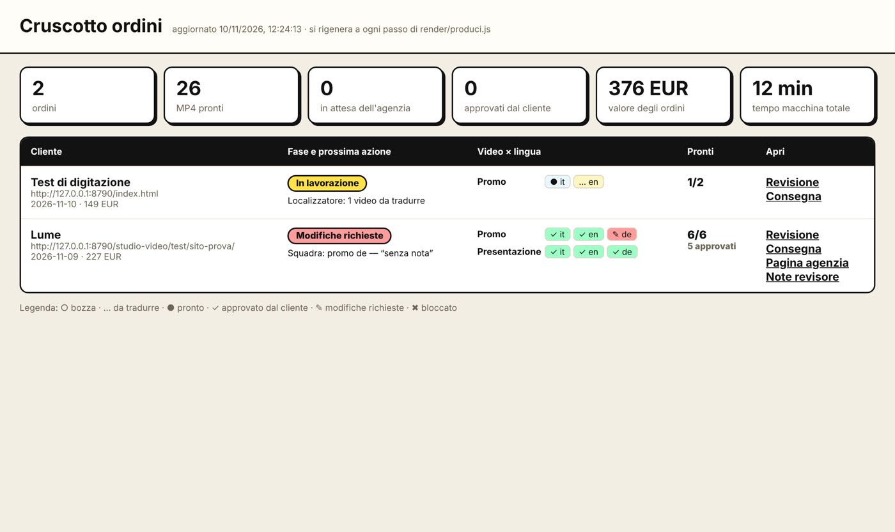
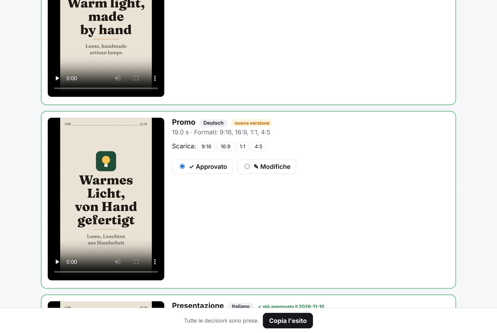
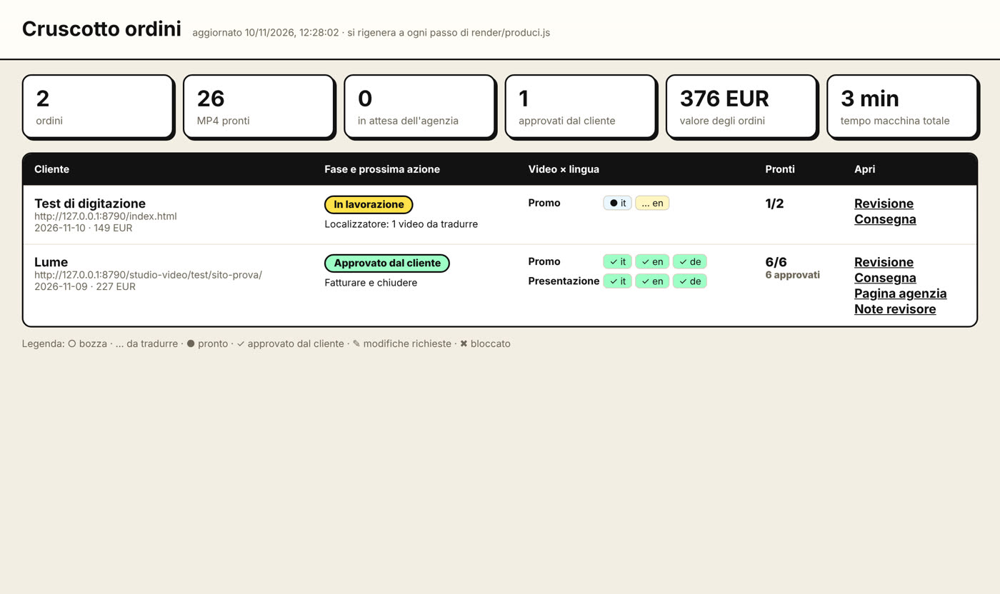
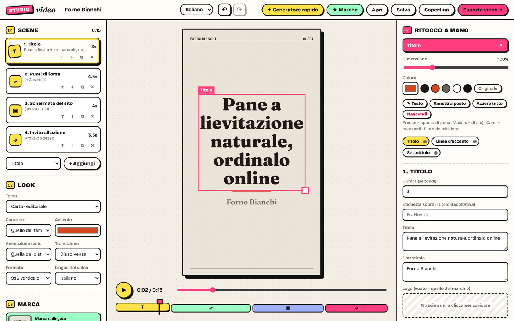
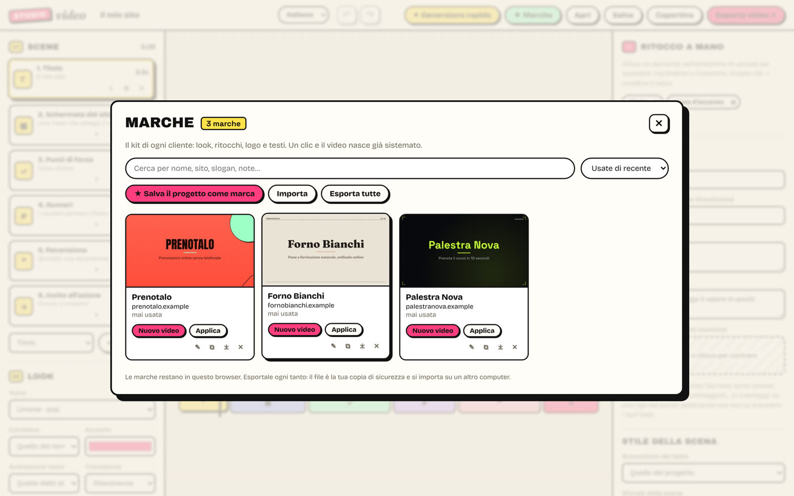

# Come funziona, dall'inizio alla fine

Il giro completo di un ordine, fatto davvero il 9-10 novembre 2026 sull'ordine
di prova **Lume** (negozio di lampade inventato, `test/sito-prova/`: sito in
italiano e inglese, tedesco da tradurre). Agenzia di prova: "Rossi Web Studio".
Ogni immagine qui sotto è una schermata vera di quel giro.

```
ordine ──► prepara ──► squadra ──► finisci ──► revisore ──► consegna ──► agenzia ──► esito
 (link,     (10 s)     (agenti)    (MP4,        (giro 1:     (pagina      decide     │
 lingue)                            pagina di    1/6;         white-label)            ▼
                                    revisione)   giro 2:6/6)              modifiche? ──► squadra ──► finisci (solo il cambiato) ──► consegna 2 ──► approvato
```

## 1. Arriva l'ordine

L'agenzia manda il link del sito del suo cliente e le lingue. In Claude Code:

```
/produci http://…/sito-prova/ cliente Lume lingue it,en,de
```

che sotto lancia:

```bash
node render/produci.js prepara <sito> --cliente "Lume" --lingue it,en,de --prezzo "227 EUR"
```

In ~10 secondi: catture del sito in italiano e (trovata da sola con `hreflang`)
in inglese, logo, bozze di promo e presentazione con **le parole del sito** in
ogni lingua, foglio da tradurre per il tedesco. Nessun numero né recensione
inventati, nessun testo di riserva tipo "Provalo adesso".

## 2. La squadra lavora (agenti, nessuna persona)

| Ruolo | Cosa ha fatto su Lume | Tempo |
|---|---|---|
| esploratore | ha visto che il sito non è fatto per il telefono: niente cattura da telefono | ~1 min |
| sceneggiatore | gancio "Luce calda, fatta a mano", punti dalla bottega toscana, solo parole del sito | ~1 min |
| art director | sito vero in un browser (non un telefono finto), piè "sito di prova" coperto, provini nei 4 formati | ~3,5 min |
| localizzatori en + de | in parallelo: inglese con le frasi del sito inglese, tedesco tradotto (registro "Sie") | ~1 min |

## 3. I video e la revisione interna

```bash
node render/produci.js finisci --cartella ordini/lume
```

24 MP4 (2 video × 3 lingue × 4 formati) e una pagina che li raccoglie tutti
con provini e controlli automatici:



Il **revisore** (agente) guarda ogni video in ogni formato. Giro 1: **1 su 6
approvato**. Errori veri: i video inglesi rimandavano al sito italiano, un
errore di grammatica in tedesco, un titolo nella zona coperta dalle icone di
TikTok. Le cause sono state corrette nel motore e negli attrezzi (non solo in
questo ordine), i testi dai localizzatori. Giro 2: **6 su 6 approvati**.


## 4. Consegna all'agenzia (white-label)

```bash
node render/produci.js consegna --cartella ordini/lume --agenzia "Rossi Web Studio"
```

Esce una cartella con una pagina **con il nome dell'agenzia, mai il nostro**
(e uno zip da 86 MB da mandare con un servizio di trasferimento): video,
formati da scaricare, avvertenze oneste (il tedesco usa schermate italiane, i
testi vanno riletti da chi conosce il mercato).



L'agenzia decide video per video. Qui approva 5 video e chiede una modifica:



Con «Copia l'esito» (o per email, con `--risposte`) manda un messaggio che
contiene una riga `ESITO-JSON`. Lo si registra:

```bash
node render/produci.js esito --cartella ordini/lume --file esito.txt
```

## 5. Il cruscotto

Tutti gli ordini, la fase, chi deve muoversi, quanto valgono
(`ordini/index.html`, si aggiorna a ogni passo):



La nota dell'agenzia ("du al posto del Sie") torna al localizzatore tedesco,
che cambia solo il pulsante della promo. `finisci` rifà **solo quel video**
(gli altri 5: "già reso, invariato") e la seconda consegna mostra "nuova
versione" sul video cambiato e "già approvato" sugli altri:



L'agenzia approva l'ultimo video: ordine chiuso, si fattura.



## 6. Il lavoro a mano, quando serve

Per ritoccare un video o farne uno da zero c'è l'editor (`index.html`): ogni
elemento si sposta, si ingrandisce, si ricolora; le marche dei clienti tengono
look e ritocchi per i video successivi.




## Quanto costa in tempo

| | Lume (3 lingue × 2 video × 4 formati) |
|---|---|
| Macchina | ~25 min in tutto (quasi solo rendering MP4) |
| Agenti | ~20 min tra squadra, 2 giri di revisione e una modifica |
| Persona | 0 nella prova; con un cliente vero la lettura della pagina di revisione (stima 10-15 min) |

## Cosa non c'è ancora

- Collaudo su siti veri (qui la rete esterna è bloccata): cookie banner, popup e pagine lente non sono ancora stati provati.
- Audio: i video sono muti (voce e musica con licenza sono la priorità 5 della roadmap).
- La pagina per l'agenzia è statica: l'esito torna per email o copia-incolla, non da solo. Un server con account è la fase 2.
- Il costo degli agenti per ordine va misurato prima di fissare i prezzi.
